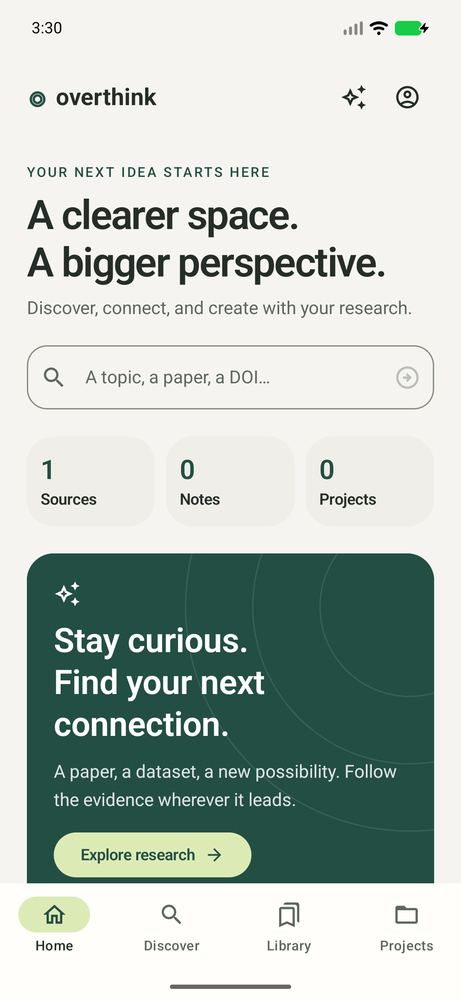
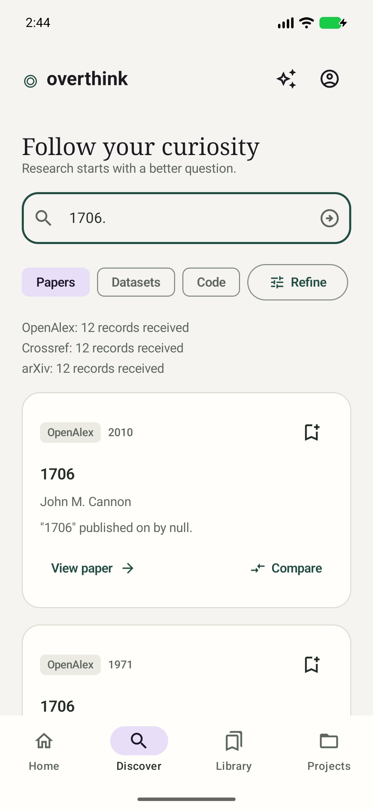
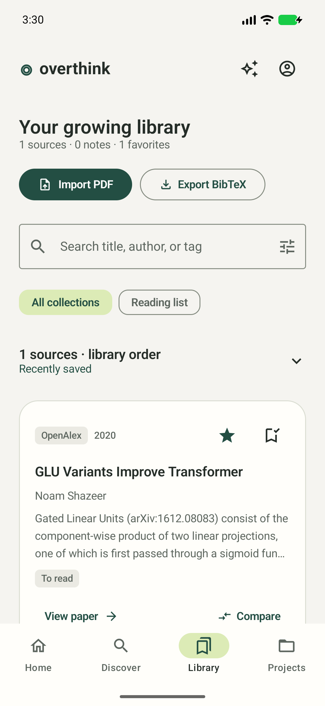
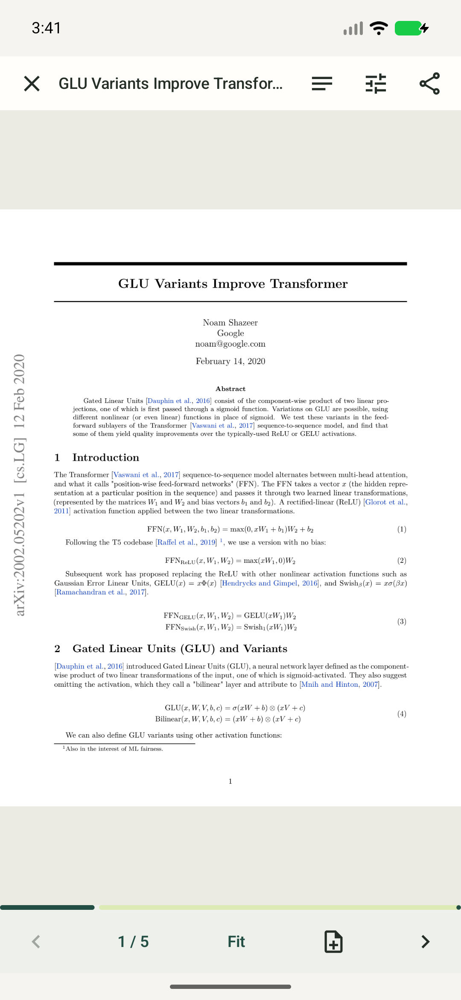

# Overthink

### Research with the source in sight.

Overthink is a native Android workspace for finding real research, reading original PDFs, and keeping notes, sources, and projects together. The current version is **2.1 preview**.

[Download the Android preview](../../releases/tag/v2.1-preview) · [See the screenshots](#preview) · [Explore customization](CUSTOMIZATION.md) · [Read the build report](REBUILD_STATUS.md)

> **Preview distribution:** Install `Overthink-2.1-preview.apk` from the release page. It is optimized and suitable for trying the app, but it uses Android's standard debug signing key. A production release needs a private release key, a hosted HTTPS backend for accounts/sync/AI, and broader device testing.

## Preview

| Home | Discover |
| :---: | :---: |
|  |  |

| Library | PDF reader |
| :---: | :---: |
|  |  |

## What you can do

- Search papers through OpenAlex, Crossref, and arXiv; search datasets through DataCite and code through GitHub. Exact DOI lookups, source/year/PDF filters, pagination, cancellation, and provider-specific failure states.
- Save sources into named collections, add tags, favorites, and reading status; filter and sort the library; import your own PDFs; export BibTeX, RIS, Markdown, and workspace JSON files through Android's document picker.
- Download and render original PDFs with Android's `PdfRenderer`. Pinch/double-tap to zoom, jump to a page, use original/sepia/night rendering and focus mode, share the file, save/edit notes, and reopen cached PDFs offline.
- Create projects manually with a research question, optional date, source links, and typed task statuses. Progress is calculated from completed tasks.
- Sign into the included backend for account-scoped synchronization and abstract-based AI assistance. Conversations persist with each workspace and source.
- Adjust 34 saved options: theme, five accent colors, typography, text size, spacing, corners, motion, haptics, launch screen, home sections, search defaults, card previews, library order, exports, and reader comfort. Screen inputs and filters survive tab navigation. See [CUSTOMIZATION.md](CUSTOMIZATION.md).

The core library and PDF reader work on the device without an account. Search needs network access to its public research providers. Accounts, sync, and AI require you to run and configure the included backend; AI remains unavailable until its server credentials and model are supplied.

## Install the preview

1. Open the [v2.1 preview release](../../releases/tag/v2.1-preview) on an Android device.
2. Download **`Overthink-2.1-preview.apk`**, then open it to install. Android may ask you to allow installation from your browser or file manager.
3. Start with Discover to find a source, save it to the Library, and open a PDF when a real PDF is available.

The larger `Overthink-2.1-debug.apk` is included in the release for development and diagnosis. Both APKs have the same application ID, so installing one replaces the other. Neither is a Play Store or production-signed build. The preview SHA-256 is `9b2a62e6e6de74d2d73053a12691e3bde6dd58aadd9843a701aa39785097cc3d`.

## Project layout

| Path | Purpose |
| --- | --- |
| [`app/`](app/) | Native Android app, Compose UI, persistence, research providers, and PDF reader |
| [`server/`](server/) | Optional account, sync, and AI service built with Node and SQLite |
| [`docs/screenshots/`](docs/screenshots/) | Captured app screens shown above |
| [`scripts/check.ps1`](scripts/check.ps1) | Local Android and backend verification |
| [`.github/workflows/check.yml`](.github/workflows/check.yml) | CI checks for both parts |

## Developer setup

The obsolete implementation and AI Studio scaffolding were removed after verifying that the native app and server did not reference them. Existing device databases are preserved; Settings offers an explicit import of old papers, their linked notes/highlight quotes, non-default projects, and recent history, excluding known sample IDs. Detached/project notes and all older schema variations are not yet covered. Keep the original database for further recovery.

### Android

Install JDK 21 and an Android SDK with `platforms;android-36.1` and build tools 36.0.0. Set `JAVA_HOME` and `ANDROID_HOME` appropriately. The Gradle 9.4.1 wrapper is included. AGP 9.1.1 supplies Kotlin; Compose compiler is 2.2.10.

PowerShell:

```powershell
./scripts/check.ps1
```

The script also recognizes a project-local JDK under `.tooling/jdk-*` if `JAVA_HOME` is missing or invalid. This rebuild's local toolchain is stored there and is ignored by Git. Other machines should install their own JDK. No custom debug keystore or Google Services file is required.

Or run directly:

```powershell
./gradlew.bat :app:assembleDebug :app:assembleRelease :app:testDebugUnitTest :app:lintDebug :app:lintRelease
```

Installable optimized local preview: `local-artifacts/Overthink-2.1-preview.apk` (signed with the standard Android debug key). Debug APK: `app/build/outputs/apk/debug/app-debug.apk`. Release builds are intentionally unsigned until you supply your own release signing configuration.

### Optional backend

Requires Node 24+. It uses Node's HTTP, crypto, and SQLite modules with no npm dependencies.

```powershell
cd server
node --env-file=.env.example server.mjs
```

By default the service listens on `127.0.0.1:8787`, stores SQLite under `server/data`, and returns an explicit unavailable response for AI. For Android Emulator, enter `http://10.0.2.2:8787` in Settings. Physical devices should use a real HTTPS deployment. Cleartext is allowed only for localhost and the emulator host address.

To configure AI, copy `server/.env.example` to `server/.env`, set `GEMINI_API_KEY` and an available `GEMINI_MODEL`, and run `node --env-file=.env server.mjs`. Credentials never belong in the Android APK. Provider access and billing are your server operator's responsibility.

Create an account from Android Settings, then use **Sync workspace**. Each account starts with its own empty library; the guest workspace is never silently uploaded. Use backup export/import to move your own records deliberately. Sync uses revision checks: simultaneous edits stop with a conflict instead of overwriting data. To resolve a conflict, export the local backup, restore the server version explicitly, merge the backup if desired, and sync again.

The service implements salted scrypt passwords, hashed expiring session tokens, rate limits, ownership-scoped queries, transactional/revisioned saves, source-ID validation for AI responses, and password-confirmed account deletion. There is no public administrator role or role elevation endpoint. Email verification, social login, and 2FA are not offered; there are no simulated security switches.

## Deployment and operations

`server/Dockerfile` provides a Node 24 image. Mount persistent storage at `/data`; put the service behind an HTTPS reverse proxy with request limits; keep its direct port private. Configure secrets through the hosting environment and back up the database. Never expose an unencrypted public service containing credentials.

```powershell
cd server
node manage.mjs backup ./backup.sqlite
node --test test/service.test.mjs
```

The backup command writes a real consistent SQLite backup using `VACUUM INTO` and refuses to replace an existing file. For restore, stop the service, preserve the existing database and its WAL/SHM files together, then restore the backup as the configured database before restarting. Verify restoration in a separate test environment before replacing production data.

Production hosting and a live AI credential have not been provisioned by this repository. No email recovery channel exists. Keep server-operator recovery procedures until a real identity-provider recovery integration is added. Passwords are never recoverable from the stored hash.

## Verification

Android tests cover serialization, account database isolation, note/link integrity, backup compatibility, citation/export escaping, staged exports across helper recreation, preference migration/persistence/validation, history opt-out, search cancellation/reset, explicit year filters, tab form retention, large-text customization, reader toolbar visibility, and screen rendering. Screenshot outputs are under `app/build/reports/screenshots`. Service integration tests cover passwords, revoked/expired sessions, ownership, revisions, malformed workspaces, account deletion, AI failure/source checks, and rate limits. CI runs the Android and backend checks.

See `REBUILD_STATUS.md` for the actual checks performed in this workspace and remaining limitations. A passing source build does not establish that all providers, devices, or AI configurations have been exercised.

## Intentional limits in this version

The reader supports original page rendering and page notes; it does not pretend to perform PDF full-text search, text highlighting, OCR, or freehand annotation. AI is explicitly abstract-only. Citations are truthful metadata-based BibTeX `@misc` entries rather than unsupported claims of complete APA/IEEE formatting. English UI currently accepts Unicode/Bangla research queries without invented translations. Team collaboration, a full browser, email recovery, native push notifications, and broader localization require further implementation.

Platform references: [AGP compatibility](https://developer.android.com/build/releases/agp-9-1-0-release-notes), [Android PDF rendering](https://developer.android.com/reference/android/graphics/pdf/PdfRenderer), [Node SQLite](https://nodejs.org/api/sqlite.html).
